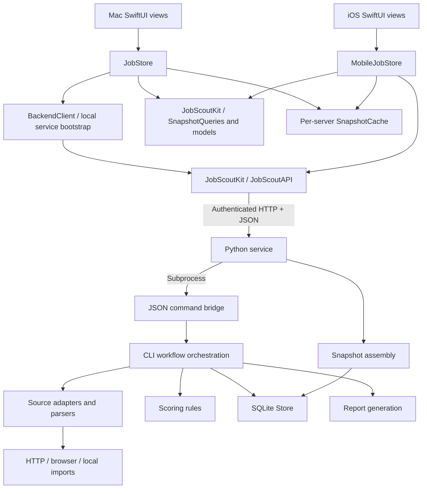

# JobScout: architecture and code guide

Reviewed October 31, 2026 against the current repository. This describes the implementation, including the simplifications from this review. It is a code review, not a confirmation of live job-site availability or device networking.

## Assessment

JobScout is a small client/server application with native presentation and a Python application backend. It uses a pragmatic MVVM-style state store in each client, a shared Swift package, HTTP transport, and a SQLite-backed collection pipeline. It does not implement a strict Clean Architecture dependency graph, and it does not need a module for every feature at its current size.

The strongest boundary is the process boundary: Python owns authoritative data, scoring and scans; Swift owns presentation and user interaction. Both clients use the same API models. Platform frameworks stay out of JobScoutKit. The weakest boundaries are inside the Mac client and Python orchestration, where several responsibilities remain combined.

## Project map

- `JobScout/JobScoutApp.swift`: Mac composition root, window/menu-bar scenes, application termination handling. Owns the store with `@State`.
- `JobScout/Models/JobStore.swift`: Mac presentation state and action coordination. Despite its directory, this is a view model/store, not a domain model. It also coordinates connection settings, rules editing, cache updates and opening reports.
- `JobScout/Models/Vacancy.swift`: an eight-line re-export shim for JobScoutKit. It defines no Vacancy type. The actual model is in the package.
- `JobScout/Views/`: Mac navigation, list, details, settings and presentation components.
- `JobScout/Services/BackendClient.swift`: Mac backend protocol, typed actions, runtime discovery/bootstrap, Python service startup and scan polling. These are infrastructure/application-adapter responsibilities.
- `JobScout/Services/MacCredentialStore.swift`: Mac Keychain access.
- `JobScoutIOS/JobScoutIOSApp.swift`: iOS composition root and store ownership.
- `JobScoutIOS/MobileJobStore.swift`: iOS presentation state, connection revisions, requests, foreground polling and offline snapshots.
- `JobScoutIOS/MobileVacanciesView.swift`: list, filters, row presentation and connection sheet.
- `JobScoutIOS/MobileVacancyDetailView.swift`: detail presentation and status actions.
- `JobScoutIOS/LANDiscovery.swift`: Bonjour discovery and resolution using Foundation delegate APIs.
- `JobScoutIOS/IOSCredentialStore.swift`: iOS Keychain access.
- `Packages/JobScoutKit/Sources/JobScoutKit/Models.swift`: shared wire models, status/mailbox rules and filter/sort enums.
- `Packages/JobScoutKit/Sources/JobScoutKit/SnapshotQueries.swift`: shared source IDs, mailbox counts, filtering and stable sorting.
- `Packages/JobScoutKit/Sources/JobScoutKit/API.swift`: authenticated URLSession transport, API errors, scan and settings response models.
- `Packages/JobScoutKit/Sources/JobScoutKit/SnapshotCache.swift`: JSON offline snapshots keyed by server identity. This is disposable client data, not the authoritative database.
- `Backend/jobscout/service.py`: authenticated HTTP entry point, mutation gate, scan process ownership, operation persistence and service startup.
- `Backend/jobscout/gui.py`: JSON-producing command bridge used by service subprocesses. Its name reflects the earlier GUI integration; it is not a UI implementation.
- `Backend/jobscout/snapshot.py`: snapshot assembly for both HTTP and the JSON command bridge. Reads database/configuration and assembles source metadata.
- `Backend/jobscout/cli.py`: command parsing and application workflow coordination: collect/import, score, persist, report and scheduling output.
- `Backend/jobscout/model.py`, `scoring.py`: vacancy normalization/identity and rule-based assessment.
- `Backend/jobscout/storage.py`: SQLite schema, transactions, deduplication, history, tracker merging and crawl cache.
- `Backend/jobscout/sources.py`, `websources.py`, `local_sources.py`: source adapters and collection orchestration.
- `Backend/jobscout/network.py`, `browser.py`, `robots.py`: HTTP/browser transport and collection policy.
- `Backend/jobscout/parsers.py`, `dom.py`, `tracker.py`: feed, HTML, alert and spreadsheet parsing.
- `Backend/jobscout/config.py`, `reporting.py`, `lifecycle.py`, `service_login.py`: configuration/migration, report rendering, scan locking/cancellation and login-service generation.
- `JobScoutTests/`, `JobScoutIOSTests/`, package `Tests/`, `Backend/tests/`: four test boundaries matching the two apps, shared library and backend.
- `project.yml`: XcodeGen source of truth for targets, settings, package references and resource membership. The checked-in Xcode project must agree with it.
- `Seed/`: initial database resource. It is copied only when a workspace database does not exist.
- `scripts/`: development utilities, including icon generation. `Build/` and `.build/` contain generated build/runtime material rather than application layers.

## Dependencies and data flow

The JSON command bridge also assembles a snapshot after each successful command. API responses cross the process boundary as Codable values; no SQLite connection or Python object crosses into Swift.

**Reading:** view → store → API → service → snapshot assembly → SQLite → JSON → store → SwiftUI. Filtering happens locally on the received snapshot.

**Changing a status:** view → typed Mac action or iOS API call → HTTP PATCH → service mutation gate → command bridge/CLI → SQLite commit → updated snapshot. The client accepts the server result rather than inventing local success.

**Scanning:** service starts a separate crawler process and returns an operation ID. Client polling observes it. Cancelling a client Task stops waiting; explicitly cancelling the scan asks the service to terminate the crawler. Closing a client does not own the server operation's lifetime.

**Offline:** each client can read its per-server JSON snapshot. No offline mutation queue silently replays actions later.

## Changes made in this review

1. Replaced the Mac client's `[String]` commands with `BackendCommand`, including associated values for status updates and imports. Missing positional arguments and unknown action spellings no longer need runtime parsing in Swift. The server's actual subprocess arguments remain strings at the process boundary.
2. Extracted common snapshot queries into JobScoutKit and reused them from both stores. Mailbox thresholds, tracker-source matching, search, score ordering and ID tie-breaking have one implementation. Each client retains its own presentation state.
3. Moved backend snapshot assembly out of `gui.py` into `snapshot.py`. The HTTP service no longer imports the command-line bridge to build a response. Replaced the nested source-mode ternary with a named function and expanded dense snapshot construction.
4. Restored standard Xcode headers in both iOS view files. Git records their creation on October 30, 2026 by Andrii Bryzhnychenko; existing file dates/authorship were preserved.
5. Removed the unused `BackendError.unreadableResponse` case and now-unused Mac threshold forwarding properties.
6. Updated existing HTTP/store tests to use typed actions and added a shared query regression test for server thresholds and tracker-platform matching.

No explanatory source comments were added. The new Swift file has the required Xcode header.

## Remaining separation concerns

### Mac store bypasses its abstraction

`JobStore.loadServerRules()`, `saveServerRules()` and `perform()` downcast `JobBackend` to `BackendClient` for settings/configuration. Consequently, a test double implementing the protocol cannot exercise the complete store behavior. This is a testability/design limitation, not evidence that current live requests fail.

A focused next change would expose connection configuration and settings operations through a deliberately scoped protocol, or inject a separate settings capability. Avoid adding silent default implementations for mutations: a fake that does nothing can make a failing workflow appear successful.

### Shared UI has a Mac-specific location

`project.yml` includes `JobScout/Views/Components.swift` in the iOS target. This is source sharing, not a runtime dependency on the Mac executable, and the file currently imports only SwiftUI. The location nevertheless hides ownership and permits a future AppKit addition to break iOS.

Move it to a neutral `SharedUI/` directory and update both the generation spec and checked-in Xcode project together. A separate UI package is optional; one shared file does not justify it alone.

### One file hides the shared model dependency

`JobScout/Models/Vacancy.swift` contains `@_exported import JobScoutKit`. Its filename suggests a model declaration and the underscored export hides which files depend on the package. Prefer explicit imports when reorganizing source membership; then remove the shim. Do not replace it with another empty forwarding model.

### Python application workflows remain in CLI parsing

`cli.main()` both parses arguments and coordinates collection, scoring, persistence and reports. The HTTP service intentionally invokes these workflows in subprocesses, preserving scan/process isolation, but application behavior remains coupled to CLI argument construction.

If adding another client or workflow, extract named application operations below the CLI, retain thin CLI/HTTP adapters, and keep the separate scan process. A wholesale rewrite would introduce more risk than the current project needs.

### Snapshot assembly still reaches through storage

`snapshot.py` queries `store.db` directly for event counts. It also performs config migration on reads, while `Store` initialization ensures schema. Moving snapshot assembly makes ownership clearer but does not make it a pure read operation. A future storage summary method and startup-owned migrations would narrow that boundary.

### Typing and file organization are uneven

Swift declarations already have required return/property types; `func action()` uses Swift's normal implicit `Void` return and does not need `-> Void` added. All authored Swift source files now have the required file headers, including the package manifest and icon script.

Python annotations remain partial, particularly in `service.py`, DOM/browser callbacks and storage helpers. This review adds signatures for the touched JSON bridge entry points, not a claim of a fully typed backend. Add useful boundary types and a static checking policy together rather than annotating dynamic JSON as `Any` everywhere.

The Mac store belongs conceptually under `Stores/` or `Presentation/`, rather than `Models/`. iOS is currently flat. These names affect navigation, not runtime dependency direction; reorganize them together with the project spec when file membership is next changed.

## Concepts and interview questions

### Observation and ownership

The app owns a reference store using `@State`; views receive it through `@Bindable` when they need bindings. `@Observable` tracks properties read by a view. It replaces the older ObservableObject/@Published ownership pattern here. Combine would be useful for an actual stream/operator pipeline; adding publishers around ordinary request/response calls would duplicate machinery.

Probe: which value owns the store's lifetime, and which view only edits it? Recreating a store from a view body can reset state and repeat work. Moving every filter into a singleton would conceal ownership.

### MainActor and actor reentrancy

`@MainActor` expresses UI-state isolation in the type system; it is stronger than dispatching one closure to the main queue. `JobScoutAPI` is an actor and wire values are Sendable. An actor is not a transaction across `await`: it can process another call while a network request is suspended.

The iOS store captures `connectionRevision` and rejects responses for an older connection. The Mac store gates actions with `isBusy` and prevents connection saving while busy. Preserve these checks during deduplication; a generic request helper that drops them can show one server's response under another server's connection.

### Tasks, cancellation and external effects

A SwiftUI `.task` follows the view lifecycle. Mac `Task` handles are explicitly retained so quitting can stop waiting and await cleanup. These Tasks are unstructured; actor inheritance does not make their lifetime structured. No TaskGroup or continuation bridge is needed for the current sequential workflows.

Probe: what happens if cancellation arrives after the server commits? Cancelling URLSession or a Task does not undo that commit. Refresh to reconcile. Explicit scan cancellation is a separate server action; polling cancellation alone must leave the scan running.

### Shared rules versus presentation state

Snapshot queries are synchronous value operations. Sharing their implementation does not require a shared observable store. Mailbox counts intentionally ignore the current search/source/role filters. Recent sorting uses discovery timestamps, then score, then ID; it preserves the existing string-date ordering rather than introducing a date-format migration.

### DI and useful tests

Mac tests inject `JobBackend`; HTTP workflow tests start a temporary real service. iOS/package tests inject URLSession using URLProtocol fixtures. Test filtering intersections, identity after status changes, custom thresholds, cache isolation, cancellation ownership and HTTP contracts. Avoid tests that merely repeat the enum's cases or mirror every computed property.

The URLProtocol fixtures use `@unchecked Sendable` with locks. The compiler cannot prove the safety of unchecked conformance; reviewers must verify every shared mutable access. A lock-protected handler is copied before invoking it, avoiding running arbitrary response code while holding the lock.

### Package boundaries

JobScoutKit is a shared client library, not a pure domain module: it contains models, mailbox policy, network transport and cache persistence. It deliberately has no SwiftUI/AppKit/UIKit dependency. Keeping one cohesive package is reasonable at this scale. Split model/domain and infrastructure targets only when dependency pressure, consumers or test/build isolation justify the added graph.

## Review limits and validation

This pass inspected target membership, app/store/service boundaries, shared models/queries/cache, backend orchestration/storage/source structure, comment/header presence, and relevant tests. It is not an exhaustive security audit or a live collector certification.

Validation on October 31, 2026:

- macOS: 11 Swift Testing tests passed, including temporary real-service import/status/report and scan ownership workflows.
- iOS Simulator (iPhone 18 Pro): 5 Swift Testing tests passed, including filter intersections, stable sorting, mailbox counts, cached reading and explicit scan cancellation.
- JobScoutKit: 6 tests passed, including the new query regression case.
- Python: 87 discovered; 82 passed and 5 optional real-browser tests skipped.
- All 26 authored Swift file headers checked; whitespace validation passed.

Optional real-browser tests require their separate runtime and were not enabled. No physical-device/LAN or visual UI checks ran. No repository commit was created.
